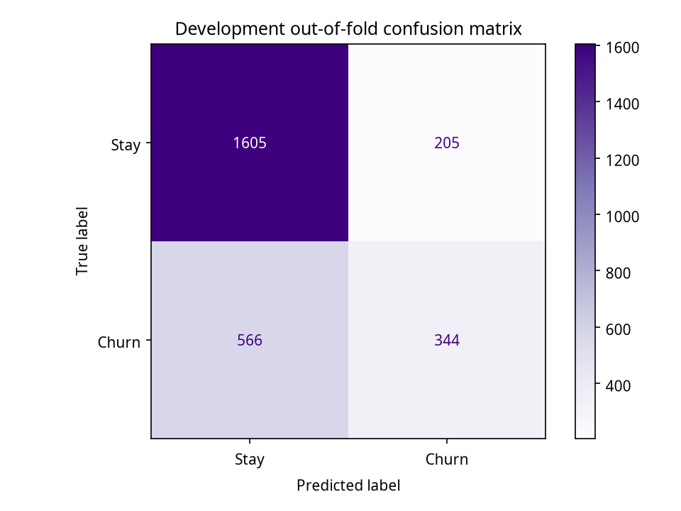
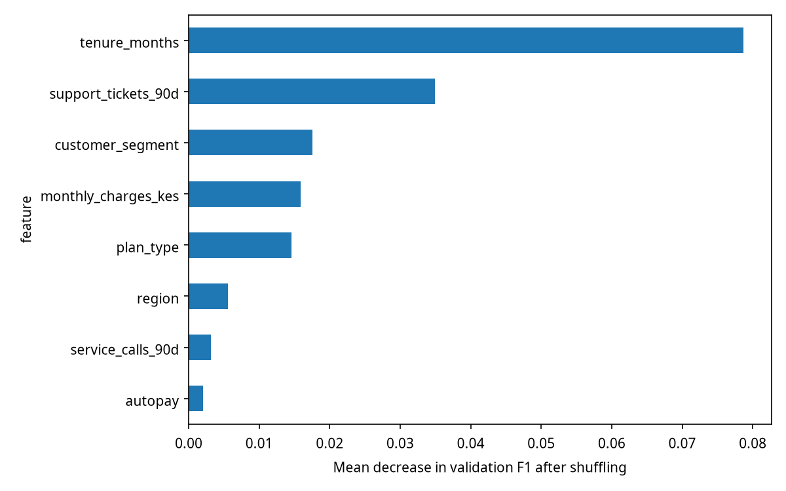

# DSA 2050A · Week 9

## Model Selection & Defensible Evaluation

A reproducible customer-churn modelling practical using a synthetic teaching dataset. The work compares models fairly, examines their errors and limitations, freezes a selection, and evaluates it once on a held-out final test set.

| Author | Student ID | Contribution |
|---|---|---|
| Tamara Mwakisha | 660146 | Data inspection, leakage prevention, modelling, evaluation, analysis, rationale, and documentation. |

---

## Results at a glance

| Selected model | Development CV F1 (mean ± SD) | Final-test F1 | Final-test recall |
|---|---:|---:|---:|
| Logistic regression (`C=1`) | **0.4701 ± 0.0527** | **0.4486** | **0.3640** |

The selected model outperformed the best tested decision tree in mean cross-validation F1 (0.3985 ± 0.0487). Final-test F1 was 0.0215 below the development CV mean. Recall remains low: on the final test the model missed 145 of 228 churners. These results support the chosen candidate among the small prescribed grids, not deployment readiness.

## Project contents

- [`notebooks/Week9_Model_Selection_Lab.ipynb`](notebooks/Week9_Model_Selection_Lab.ipynb) — completed notebook with visible outputs and written reflections.
- [`data/`](data/) — synthetic development and final-test datasets.
- [`reports/experiment_log.csv`](reports/experiment_log.csv) — all tested grid settings and fold scores.
- [`reports/subgroup_metrics.csv`](reports/subgroup_metrics.csv) — out-of-fold segment metrics.
- [`reports/permutation_importance.csv`](reports/permutation_importance.csv) — feature-reliance results.
- [`reports/frozen_selection.json`](reports/frozen_selection.json) — model and rationale recorded before final testing.
- [`reports/final_metrics.json`](reports/final_metrics.json) — one-time final-test results.
- [`reports/development_confusion_matrix.png`](reports/development_confusion_matrix.png) and [`reports/permutation_importance.png`](reports/permutation_importance.png) — generated figures.

## Data and leakage controls

The target is `churn` (`1` = cancelled, `0` = stayed); each row represents one customer. The development dataset has **2,720 rows**, including **910 churners (33.46%)** and **1,810 retained customers (66.54%)**. Missing values occur in monthly charges (156), support tickets (120), and region (93). There are no exact duplicate rows. The records are synthetic and do not represent actual telecom customers.

Eight candidate features are used: `tenure_months`, `monthly_charges_kes`, `support_tickets_90d`, `service_calls_90d`, `plan_type`, `region`, `autopay`, and `customer_segment`. Their availability before a real prediction time would need to be verified.

- **Excluded `customer_id`:** an identifier that may encourage memorization and is not a defensible generalizable predictor.
- **Excluded `cancellation_confirmed`:** a post-outcome leakage field. In this dataset it maps `Active` to `churn=0` and `Cancelled` to `churn=1`; using it would reveal the outcome.
- **Excluded `churn`:** the target, not a predictor.

The final test set remained unopened during exploration, preprocessing, cross-validation, and selection. The chosen model was frozen before its single final evaluation.

## Method

Numeric variables receive median imputation and standard scaling. Categorical variables receive most-frequent imputation and one-hot encoding. Preprocessing is inside each model pipeline, so it is fitted using training-fold data only.

All candidates use the same five stratified folds (`shuffle=True`, `random_state=42`) and F1 selection rule. The majority-class dummy baseline has **0.000 F1 in every fold**: predicting every customer as retained could appear to give about 66.5% accuracy, while detecting no churners.

The prescribed grid search compared logistic regression (`C = 0.1, 1, 10`) with decision trees (`max_depth = 3, 5, 8`).

## Cross-validation results

| Model family | Best setting | Mean F1 | F1 SD | Fold F1 scores (1–5) | Mean precision | Mean recall |
|---|---:|---:|---:|---|---:|---:|
| Logistic regression | `C=1` | 0.4701 | 0.0527 | 0.3915, 0.5342, 0.4718, 0.4345, 0.5185 | 0.6243 | 0.3780 |
| Decision tree | `max_depth=3` | 0.3985 | 0.0487 | 0.3920, 0.4571, 0.3158, 0.4367, 0.3906 | 0.5656 | 0.3176 |

**Selection:** Logistic regression (`C=1`) leads the best tree by 0.0716 mean F1 and has higher mean recall. Its fold SD is slightly higher (0.0527 vs. 0.0487), so it is not the more stable candidate by this estimate. `C=10` produced the same displayed scores as `C=1`; there is no measured benefit to selecting the less-regularized setting. The choice reflects the strongest tested candidate, not a claim that the model is ready for operational use.

## Errors and customer segments

Out-of-fold development predictions yield churn recall of **0.378**: **566 false negatives** (churners predicted to stay) and **205 false positives** (retained customers flagged as risks). False negatives can mean missed retention opportunities; false positives can consume retention resources.

| Segment | Customers | Actual churners | Recall | Precision | False negatives |
|---|---:|---:|---:|---:|---:|
| Established | 2,268 | 649 | 0.2157 | 0.5932 | 509 |
| New | 452 | 261 | 0.7816 | 0.6518 | 57 |

Established-customer recall is markedly lower in these out-of-fold predictions. This synthetic-data result warrants investigation, not a claim about real customer populations.



## Permutation importance

On a held-out 25% slice of development data, importance was measured as mean F1 reduction after shuffling a feature (five repeats).

| Feature | Mean F1 reduction | SD |
|---|---:|---:|
| `tenure_months` | 0.0787 | 0.0237 |
| `support_tickets_90d` | 0.0350 | 0.0157 |

These results describe predictive reliance in this model and slice, **not causation**. Correlated predictors may share or mask importance, and estimates can vary with the sample and fitted model.



## Frozen choice and final test

Before opening the final test data, the selection was frozen as **logistic regression (`C=1`)**, with F1 as the primary metric. The rationale weighs CV mean and variation, missed churn, subgroup recall, and model simplicity. See [`reports/frozen_selection.json`](reports/frozen_selection.json) for the saved decision record.

After freezing, the pipeline was refit on all development data and evaluated once on 680 final-test observations.

| Final-test metric | Result |
|---|---:|
| Accuracy | 0.7000 |
| F1 | 0.4486 |
| Precision | 0.5845 |
| Recall | 0.3640 |

Confusion matrix (rows = actual; columns = predicted; class order = stayed, churn):

|  | Predicted stayed | Predicted churn |
|---|---:|---:|
| **Actual stayed** | 393 | 59 |
| **Actual churn** | 145 | 83 |

The final score evaluates the frozen model; it was not used to retune or choose a new model. Any issue revealed by that evaluation is a limitation to report—not a reason to present a revised score from the same test as unbiased.

## Reflection

1. **Why should models share folds?** Identical stratified folds make the validation partitions comparable and reduce the chance that one model wins only because it received easier partitions. Stratification keeps approximate class balance in each fold.
2. **What does F1 measure?** The harmonic mean of precision and recall. It balances finding churners against false alarms, but it does not encode business error costs and can hide subgroup differences.
3. **Where do errors concentrate?** Development out-of-fold predictions include 566 false negatives and 205 false positives; Established customers account for 509 missed churners. Final testing produced 145 false negatives and 59 false positives.
4. **What is the highest-reliance feature?** `tenure_months` (mean F1 reduction 0.0787), followed by `support_tickets_90d` (0.0350). Importance is not evidence of causation.
5. **Why not tune on the final test?** Repeated choices based on final scores adapt the model to that test and compromise its independence as an evaluation set. Use it once for the frozen choice.
6. **What are the limitations and a next step?** The data are synthetic and may not reflect actual behavior or measurement; the exercise does not establish real feature timing, intervention costs, or temporal change. Before deployment, validate on representative, time-separated data; confirm feature availability; assess subgroup performance, calibration, privacy, and intervention costs; and set any operating threshold using development data only.

## Reproduce

Use Python 3.10–3.13 if available. From the repository root:

```bash
python -m venv .venv
# macOS/Linux: source .venv/bin/activate
# Windows PowerShell: .venv\Scripts\Activate.ps1
python -m pip install -r requirements.txt
jupyter notebook notebooks/Week9_Model_Selection_Lab.ipynb
```

The notebook has been run end to end. The final evaluation cell reads saved results if `reports/final_metrics.json` exists, rather than rerunning the test. Preserve this guard; do not delete the file to obtain a new score unless instructed to conduct a separately versioned evaluation.
